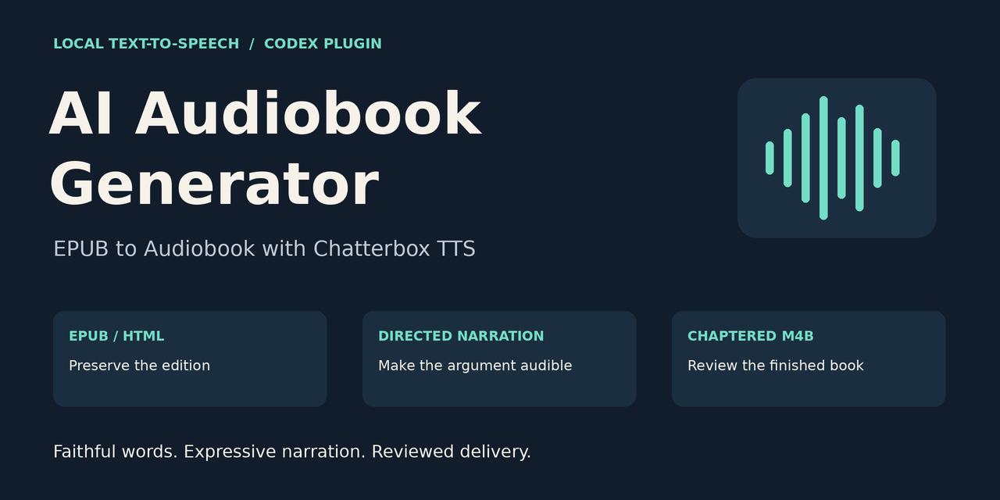

# AI Audiobook Generator — EPUB to Audiobook with Chatterbox TTS

**Convert EPUB to audiobook** with expressive English narration, reference-voice conditioning,
and **chaptered M4B export**. AI Audiobook Generator uses **Chatterbox TTS** for local
text-to-speech and a **Codex plugin** to prepare EPUB or HTML books, direct their performance,
and review the finished audiobook. It preserves the source wording and makes rhetorical
direction, voice generation, and delivery traceable to the edition.

**Status:** development preview · English · Python 3.13 · local execution required

[](LICENSE)
[](pyproject.toml)



[Install](#installation) · [Quick start](#quick-start) · [How it works](#the-domain-pipeline) ·
[Documentation](https://fredfortier.github.io/ai-audiobook-generator/) · [Development](#development) ·
[Issues](https://github.com/fredfortier/ai-audiobook-generator/issues)

## Why expressive AI audiobook narration?

> Some texts were made not only to be inspected on a page, but to act on a
> gathered audience through a voice. Ancient letters moved between writing and “living voice,” and
> early Christian epistles preserve evidence of public reading and performance. 
> ([Pérez Cortés](https://doi.org/10.22201/ffyl.16656415p.1998.7.206),
> [Byrskog](https://journals.lub.lu.se/pna/en/article/view/23073),
> [Hurtado](https://doi.org/10.1017/S0028688514000058))

That premise creates an opportunity. A modern audiobook can recover something of the text's
address—its inquiry, argument, warning, invitation, and exhortation—without rewriting the work or
pretending to reconstruct an unknowable historical performance. Original
[Chatterbox](https://github.com/resemble-ai/chatterbox) makes this technically plausible: it is an
open English text-to-speech model with reference-voice conditioning and direct controls for
exaggeration, classifier-free guidance, and sampling. But expressive controls alone do not know
what a passage is doing. Turning every elevated sentence “dramatic” would replace interpretation
with mannerism.

This project therefore treats an audiobook as **directed oral interpretation**:

```text
admitted source
    -> source-exact rhetorical score
    -> speech-faithful adaptation
    -> controlled voice generation
    -> listened-to, source-accountable delivery
```

Each arrow has a distinct owner and an inspectable artifact. The result is not a generic “EPUB to
speech” converter. It is a production system for making faithful, rhetorically alive audiobooks
whose words, interpretive decisions, generated audio, and final navigation remain traceable to the
edition.

## EPUB to audiobook features

- Prepare EPUB or HTML while retaining edition, reading order, headings, and source locators.
- Direct eight rhetorical actions with a source-exact score before adapting prose for speech.
- Render with original English Chatterbox TTS and a reference voice; audition before full production.
- Resume hash-verified segments and keep alternative performances in separate workspaces.
- Assemble lossless audio and export chaptered M4B with verified metadata.
- Require editorial and listening review before treating a delivery as complete.

## Installation

This is a local Codex plugin containing three skills and their Python helpers. Install it through
its repository marketplace. Use a clean checkout, before creating environments or book work
inside it; local installation copies the plugin directory. In that checkout:

```sh
codex plugin marketplace add .
codex plugin add ai-audiobook-generator@ai-audiobook-generator
```

Install directly from the GitHub repository:

```sh
codex plugin marketplace add https://github.com/fredfortier/ai-audiobook-generator.git
codex plugin add ai-audiobook-generator@ai-audiobook-generator
```

The commands above match Codex CLI 0.163.0. Check `codex plugin --help` for your installed version.
You can also open `/plugins` in Codex and install **AI Audiobook Generator** from this marketplace.
Start a new session after installing. The package uses the
[official portable plugin layout](https://developers.openai.com/plugins/build/plugins):
`plugin.json`, `skills/`, and `.agents/plugins/marketplace.json`. No MCP server is required.

### Runtime

Install [uv](https://docs.astral.sh/uv/getting-started/installation/) before using the plugin.
The skills resolve their installed location and run the shared locked project:

```sh
uv run --project "<skill-root>/../.." --locked --no-dev audiobooks …
```

uv supplies Python 3.13 and Python dependencies. Pandoc is bundled by `pypandoc-binary`;
NLTK obtains missing English Punkt data with its native downloader; `static-ffmpeg` obtains
FFmpeg and ffprobe automatically. No separate toolchain installation or resource-path setup
is needed. First use requires internet and disk space for dependencies and model weights.
A compatible CUDA GPU is recommended; CPU and MPS are explicit renderer options.

Book work defaults to `~/Audiobooks/work/`. Optionally set `WORKSPACE_DIR` to another persistent
location. Set `EXPORT_DIR` to your finished library before exporting. Keep both outside plugin caches.

### Other agents: manual installation

From a checkout, install the shared CLI, then install the three skills with
[Skills CLI](https://github.com/vercel-labs/skills) (requires Node.js):

```sh
uv tool install --python 3.13 /absolute/path/to/ai-audiobook-generator
npx skills add /absolute/path/to/ai-audiobook-generator --global --skill preprocess-text adapt-text chatterbox
```

Choose your agent when prompted. Alternatively, copy the skill folders:

```sh
mkdir -p ~/.agents/skills
cp -R /absolute/path/to/ai-audiobook-generator/skills/. ~/.agents/skills/
```

Separately installed skills use `audiobooks …`; `audiobooks runtime-root` locates the bundled
voice, workspace contract, and optional role instructions. If the command is absent from `PATH`,
run it by its absolute path under `uv tool dir --bin`.

## Quick start

In Codex, ask:

```text
Use preprocess-text to prepare /absolute/path/book.epub for an English audiobook.
Keep the edition and source provenance. Put this book under my WORKSPACE_DIR.
Then use adapt-text for a reviewed rhetorical score and faithful speech adaptation.
Audition representative passages with chatterbox before rendering the complete book.
Deliver a reviewed chaptered M4B to my EXPORT_DIR.
```

| Skill | Input | Output |
| --- | --- | --- |
| `preprocess-text` | EPUB or HTML edition | Admitted source bundle with units and sections |
| `adapt-text` | Admitted bundle and reviewed brief | Acting score, speech scripts, coverage ledger |
| `chatterbox` | Accepted scripts and model snapshot | Auditions, verified segments, assembly, M4B |

The agent asks for scope or editorial decisions when the source is ambiguous. You review the
performance and listen to the final delivery. These are deliberate production checkpoints.

The plugin has one Python package, one root `pyproject.toml` and `uv.lock`, and one shared
Typer CLI. To inspect source structure and commands without loading a speech model:

```sh
uv run --locked audiobooks preprocess inspect /absolute/path/book.epub
uv run --locked audiobooks adapt --help
uv run --locked audiobooks render --help
```

| Command group | Operations |
| --- | --- |
| `audiobooks preprocess` | `inspect`, `select-sections`, `upgrade`, `audit-corpus` |
| `audiobooks adapt` | Briefs, score packets, validation, acceptance, revision, script export |
| `audiobooks render` | `plan`, `generate`, `status`, schemas, verified revision imports |
| `audiobooks delivery` | `assemble`, `encode`, `export` |

Use `--help` on any group or command for its arguments. `uv run --locked audiobooks completion bash`
prints Bash completion; `zsh` and `fish` are also supported. Completion generation accepts the shell
explicitly and works from agent runtimes and CI. Shell completion requires the installed
`audiobooks` command on `PATH`.

The optional [director](.codex/agents/text-director.toml) and
[adapter](.codex/agents/text-adapter.toml) role definitions are project-local Codex configuration.
Plugin installation does not register them as custom roles in another project. The adaptation
skill explains how to supply their contracts explicitly and how to report unavailable models.

## Direction begins with the listener

The direction framework joins three established ideas.

First, rhetoric is audience-oriented. The hearer is the determinant of a speech's end
and object, and distinguishes reasoning in the speech from the effects produced in its hearers
([*Rhetoric* I.2–3](https://classics.mit.edu/Aristotle/rhetoric.1.i.html)). Second, delivery must be
appropriate both to the whole work and to the local function of a passage. 
Third, oral interpretation preserves a literary work while communicating its intellectual,
emotional, and aesthetic whole to an audience; it does not license the performer to replace the
text ([Gura and Lee, *Oral Interpretation*](https://www.routledge.com/Oral-Interpretation/Gura-Lee/p/book/9781138082212)).

The repository turns those ideas into a deliberately small directing grammar. A director reads the
complete short work—or a coherent section of a longer work—before dividing it into moves. Every
move answers one question:

> What must the narrator cause the listener to do here?

The answer has a normative form:

> **[ACTION] the listener to [observable response] by [textual tactic].**

Eight actions cover the current domain:

| Action | Listener task |
| --- | --- |
| `CLARIFY` | Make a relation, premise, qualification, or example intelligible. |
| `PROBE` | Recruit the listener into a genuinely unresolved question. |
| `CONVINCE` | Seek acceptance or rejection through reasons, counterexample, or inference. |
| `WARN` | Make an adverse consequence or moral danger matter. |
| `INVITE` | Make the listener receptive to a possibility, image, or inward prospect. |
| `EXALT` | Enlarge an earned vision, magnitude, wonder, or desire. |
| `URGE` | Move the listener to undertake a commanded act. |
| `RESOLVE` | Land and retain a concluding distinction or settled alternative. |

A move begins when the listener's task changes—not automatically at punctuation, a paragraph
boundary, or an impressive word. Every narrated source character belongs to exactly one ordered
move. Each move retains its exact source span, action, objective, and local textual evidence. Mood,
emotion, tempo, and numeric model settings are deliberately absent from the score: “sound mystical”
is not an actionable or falsifiable reading of a sentence.

This separation matters. The text director makes the semantic decision once. A processing pass may
normalize a number for speech or map a source move across a delivery boundary, but it may not
reinterpret the prose. Each accepted action resolves through one registry to a complete Chatterbox
control vector. The renderer may revise a vector only after matched-text auditions; acoustic
calibration can change how an action sounds, but not what the passage means. The precise contract is
in [source-exact acting direction](skills/adapt-text/references/acting-direction.md) and
[Chatterbox performance mapping](skills/adapt-text/references/performance.md).

## The domain pipeline

The five workspace stages are also the five production boundaries:

```text
source witness
     │
     ▼
 prepared ── admitted units, sections, roles, provenance
     │
     ▼
 adaptation ── direction score, normalized speech, delivery beats, canonical scripts
     │
     ▼
 render ── frozen generation plan, model/voice identity, verified audio segments
     │
     ▼
 assembly ── lossless ordered audio, reviewed gaps, realized chapter positions
     │
     ▼
 delivery ── encoded M4B, metadata, quality record, finished-library export
```

### Prepare the edition

`preprocess-text` turns HTML or EPUB into a retained, paragraph-preserving source bundle. For EPUB,
the spine establishes reading order while NAV/NCX and document structure provide section evidence;
the pipeline refuses ambiguous boundaries rather than manufacturing chapters. Every admitted unit
keeps stable identity, source locators, role, section, and preparation history. Body text,
paratext, headings, verse, notes, and apparatus remain distinguishable because later stages cannot
faithfully recover distinctions that intake discarded.

### Direct and adapt the text

`adapt-text` first freezes the edition-specific brief: scope, addressee, throughline, voice,
pronunciation concerns, source-grounded rules, and performance limits. It then creates and reviews
the source-exact acting score. Only after the complete score is accepted does adaptation proceed
through the text in source order.

Adaptation preserves diction, sentence order, quotations, verse, and paragraph lineage. It may make
justified speech-surface changes—expanding an unambiguous number, removing an indexed note call, or
adjusting punctuation for speech—but every nontrivial edit is recorded. Each source unit ends as
`narrated`, `excluded`, or `unresolved`; silence is never allowed to masquerade as a decision.

### Render the accepted performance

`chatterbox` freezes the exact scripts, voice, model files, tokenizer, seed, device, controls, and
physical segmentation before generation. Semantic delivery beats may be subdivided to fit the
model, but their words and control vector remain unchanged. The default narrator is Enoch at
[`assets/voices/enoch.wav`](assets/voices/enoch.wav).

Representative passages are auditioned before a complete render. Generation success is only a
machine event: it does not establish correct words, suitable pacing, intact endings, natural joins,
or convincing action. Segment identity and hashes make a diagnosed retry local and prevent stale
audio from being silently attached to a changed plan.

### Assemble, listen, and deliver

Assembly preserves decoded source samples in plan order and derives chapter times from realized
audio, not estimated reading speed. Gaps and chapter titles are reviewed data. Delivery encodes the
lossless assembly to M4B, reopens it to verify stream and chapter metadata, and binds the output to
its inputs and tool versions.

Quality review combines source comparison, measurements, ASR as a fallible diagnostic, and actual
perceptual review. Automated transcription can point to an omission or repetition; it cannot
certify acting, classical pronunciation, or polish. A book is complete only when the final encoded
artifact—not merely its scripts or WAV inventory—passes the relevant checks and is exported or has
an explicit no-export decision.

## Architecture

Content hashes bind source units, reviewed scripts, render requests, and saved audio. Changed inputs invalidate reuse; validation failures block the affected stage.

| Modules | Responsibility |
| --- | --- |
| [`epub_structure`](src/audiobooks/epub_structure.py), [`epub_sections`](src/audiobooks/epub_sections.py) | EPUB reading order and section evidence |
| [`source_units`](src/audiobooks/source_units.py) | Source admission, provenance, and work partitioning |
| [`adaptation`](src/audiobooks/adaptation.py) | Briefs, acting scores, acceptance, revisions, and script export |
| [`script_contract`](src/audiobooks/script_contract.py) | Typed script records and Markdown codec |
| [`segmentation`](src/audiobooks/segmentation.py), [`rendering`](src/audiobooks/rendering.py) | Token limits, frozen generation requests, and verified segment recovery |
| [`assembly`](src/audiobooks/assembly.py), [`delivery`](src/audiobooks/delivery.py) | Sample-preserving assembly, M4B encoding, metadata verification, and export |

See the [production specification](skills/adapt-text/SPEC.md) for cross-stage invariants and
acceptance conditions.

## Project workspaces

Generated books do not live beside source code. Set `WORKSPACE_DIR`, or use the default
`~/Audiobooks/work/`, and give each book one short, familiar directory name:

```text
$WORKSPACE_DIR/<book-name>/
  WORKPAD.md
  prepared/
  adaptation/
  render/
  assembly/
  delivery/
```

`WORKPAD.md` is the durable editorial memory. Its `Blueprint` records the edition, narration scope,
voice, intended delivery, and completion boundary; its dated `Material record` retains decisions or
surprises that could change later work. Machine progress, hashes, and per-segment results stay in
their stage records.

Set `EXPORT_DIR` to the finished-library root. Successful deliveries are exported as stable,
source-derived M4B paths; named sibling performances can coexist as variants. See
[`workspace/AGENTS.override.md`](workspace/AGENTS.override.md) for the editorial workspace contract
and the Chatterbox skill for final naming and verification.

## Development

Run `uv sync --locked` in a checkout. [AGENTS.md](AGENTS.md) defines the development contract and
required checks; [CI](https://github.com/fredfortier/ai-audiobook-generator/actions/workflows/python-checks.yml)
runs those checks independently. The [test audit](tests/README.md) records regression coverage;
[typing boundaries](docs/typing-boundaries.md) document external-library exceptions.

## Updating existing work

Runtime and dependency hashes intentionally invalidate old render plans when the implementation
changes. Keep earlier production workspaces intact and freeze a new plan after an update. Older
adaptation exports lack script hashes: run the adaptation helper's `export <workspace>` command
again to revalidate accepted work and bind its scripts before planning a new render. Directed
revisions require a new reviewed score and adaptation; old score-move lineage is not carried over.

## Limitations

English narration and original Chatterbox are the supported scope. Automated validation proves
structural properties and content identities; it does not certify interpretation, pronunciation,
or listening quality. Generated book audio and private production records are not bundled. The
Plotinus test fixture supports source and chapter checks; it is not a downloadable audiobook demo.

## Contributing

Follow [the contribution guide](.github/CONTRIBUTING.md). Report vulnerabilities through
[private security reporting](.github/SECURITY.md).
For a bug report, include the command, Python and OS versions, failure message, and a minimal input
you have permission to share. Keep private books, voice recordings, and credentials out of issues.

## License and credits

Original project code and skill prose are licensed under [MIT](LICENSE). The bundled
[Enoch reference recording](assets/voices/README.md) is licensed under CC BY 4.0. Dependencies,
model weights, and source editions retain their own terms; EbookLib includes an AGPL notice.

Built with [Chatterbox](https://github.com/resemble-ai/chatterbox),
[EbookLib](https://github.com/aerkalov/ebooklib), [Pandoc](https://pandoc.org/),
[Panflute](https://github.com/sergiocorreia/panflute), [NLTK](https://www.nltk.org/), and
[FFmpeg](https://ffmpeg.org/). The retained Plotinus fixture includes its Project Gutenberg notice.
